# DragonForce VPN

**Built by DragonForce. Powered by Xray-core.**

DragonForce VPN is a Windows desktop VPN client that brings server management, traffic routing, network-level filtering, and connection monitoring into one clear interface. Import your own VLESS or VMess configurations from a provider or a server you manage, then connect through System Proxy or full-device TUN mode.

It is designed for everyday use with practical controls: choose which destinations use the VPN, manage subscriptions, share profiles through QR codes, and keep track of your traffic without hand-editing configuration files.

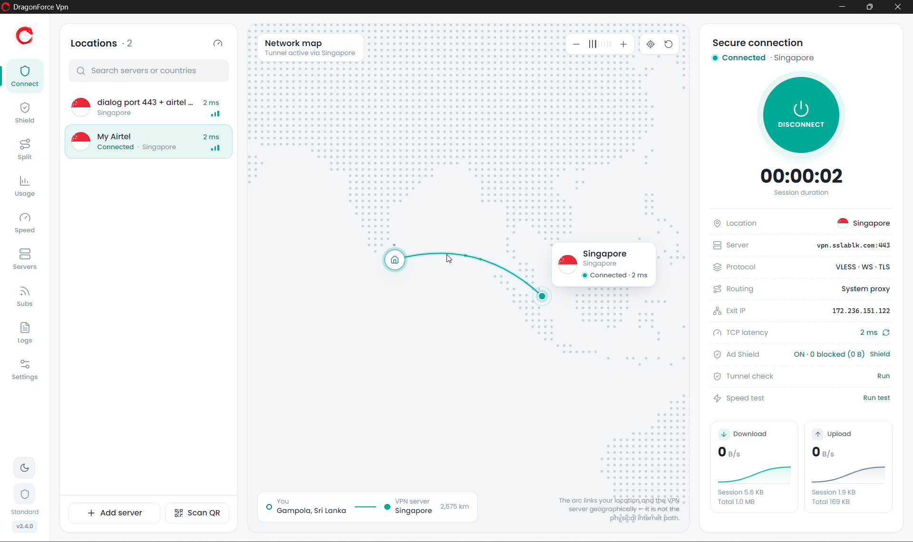

## Why use DragonForce VPN?

- **Your servers, your choice:** use your own connection links and subscriptions.
- **Control your traffic:** choose proxy or TUN routing, with domain and IP-based split tunneling.
- **Everything in one place:** manage connections, filtering, usage, and troubleshooting from the same app.
- **Ready for Windows:** choose an installer or a portable EXE for x64, ARM64, or x86.

## Features

- **VLESS & VMess profiles** with TCP, WebSocket, gRPC, HTTPUpgrade, and XHTTP transports, plus TLS and Reality settings.
- **Interactive dashboard** with server locations, connection status, exit IP, and live upload/download activity.
- **System Proxy & Full TUN** modes, local HTTP/SOCKS5 ports, LAN bypass, and terminal proxy controls.
- **Smart Split Tunneling** with Bypass VPN and VPN Only modes, app/website-group presets, custom domains/IP subnets, and a route inspector.
- **Privacy & Ad Shield** with ad, tracker, and malware-domain filtering, custom blocklists, allowlists, optional AdGuard DNS, and blocked-connection logs.
- **Usage analytics & speed tests** with traffic history, per-server usage, data-cap alerts, optional cap-triggered disconnect, and download/upload testing.
- **Server & subscription management** with profile editing, latency checks, feed refresh, and quota/expiry information where available.
- **QR Code Studio** for sharing profiles and importing QR codes from images, clipboard, screen capture, or a camera.
- **Legacy configuration compatibility** for encoded paths from NetMod/older panels and servers requiring the Allow insecure certificate option.
- **Desktop conveniences** including light/dark themes, live logs, locally saved preferences, and network-setting restoration when disconnecting or closing the app.

## Installation

Download the installer or a portable build from the **[latest release](https://github.com/dumidulkdev/Dragonforce-Vpn/releases/latest)**.

| Download | Choose it for |
| --- | --- |
| `DragonForce-VPN-<version>-Setup.exe` | Installation with automatic architecture selection |
| `DragonForce-VPN-<version>-x64-Portable.exe` | Intel/AMD 64-bit Windows |
| `DragonForce-VPN-<version>-arm64-Portable.exe` | ARM64 Windows, including Snapdragon PCs |
| `DragonForce-VPN-<version>-ia32-Portable.exe` | 32-bit x86 Windows |

Requires **Windows 10 or 11** with a matching architecture. Release builds include the application runtime and VPN engines.

## How to use

1. **Open DragonForce VPN** and complete or skip the welcome tour.
2. **Add a connection:** paste a `vless://` or `vmess://` link in **Servers**, add a feed in **Subs**, or use **Scan QR**.
3. **Choose a routing mode** in **Settings**:
   - **System Proxy** routes applications that use Windows proxy settings.
   - **Full TUN** captures device traffic through the virtual adapter. Use **Restart as administrator** to enable it.
4. **Select a server and connect.** Use the dashboard's **Tunnel check** to verify the connection.
5. **Customize your connection:** configure filtering in **Shield**, routing rules in **Split**, and traffic limits in **Usage**. Run **Speed** for a speed test or open **Logs** for troubleshooting.
6. **Disconnect when finished.** Closing the desktop window also disconnects and restores the network settings the app changed.

For servers requiring `allowInsecure=true`, open **Edit server → Security → Allow insecure certificate**, save, and reconnect. Encoded WebSocket paths such as `%252fws%252fchat` are normalized to `/ws/chat` automatically.

Installed and portable builds save profiles and preferences in `%APPDATA%\DragonForce VPN`.

## Screenshots

<details>
<summary>Explore the app</summary>

| | |
| --- | --- |
| **Server Manager**<br>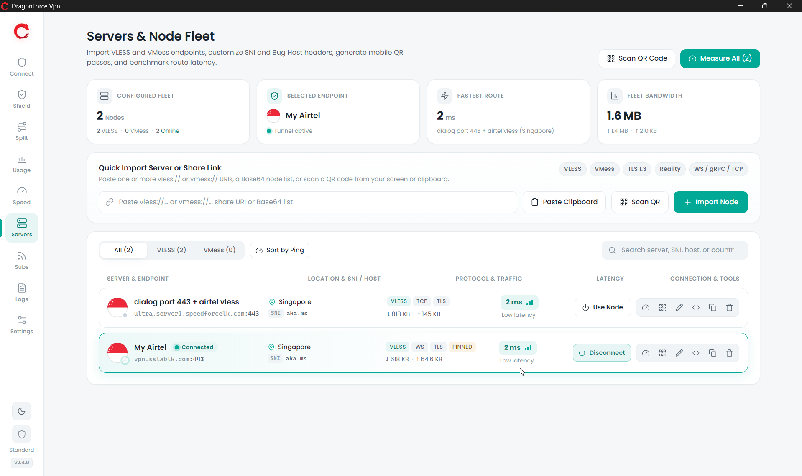 | **Server Editor**<br>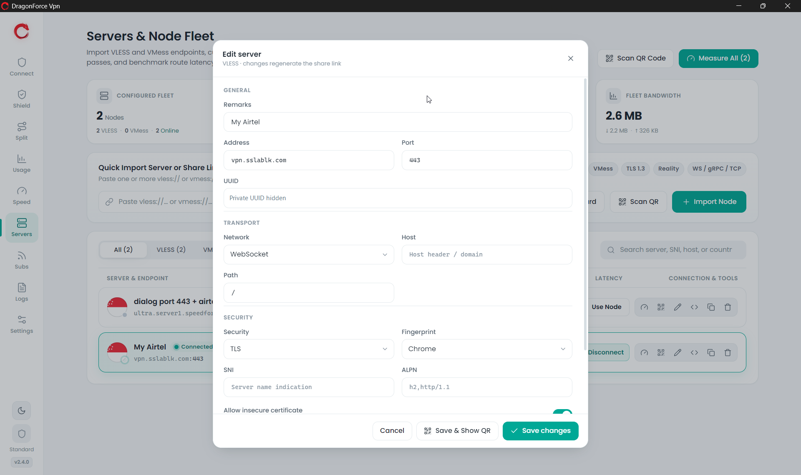 |
| **Privacy & Ad Shield**<br>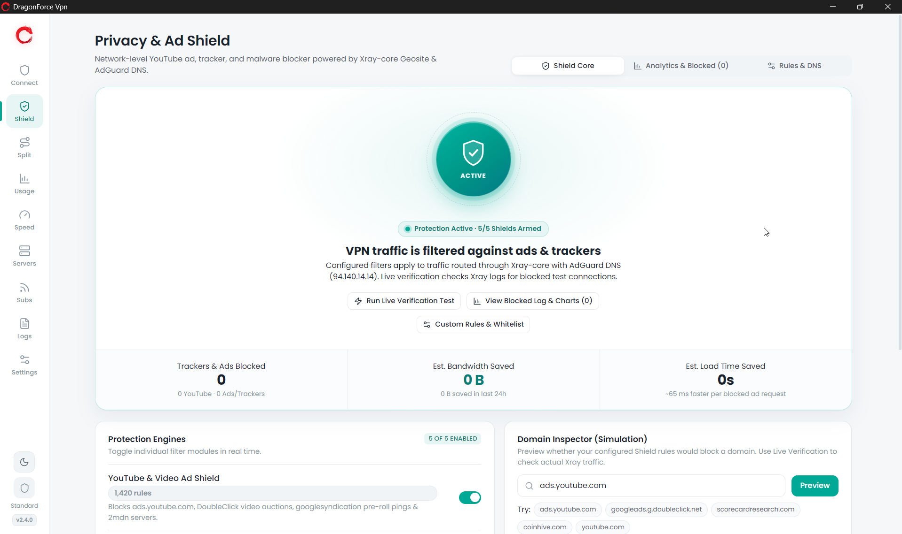 | **Smart Split Tunneling**<br>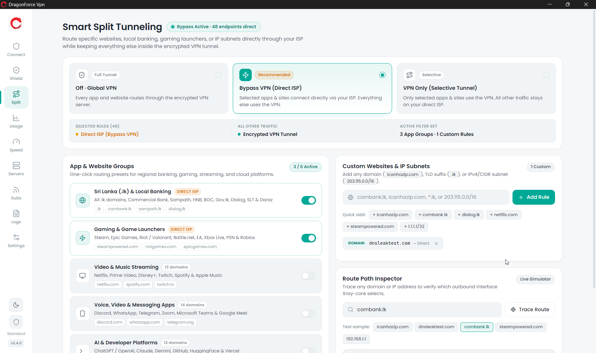 |
| **Usage Analytics**<br>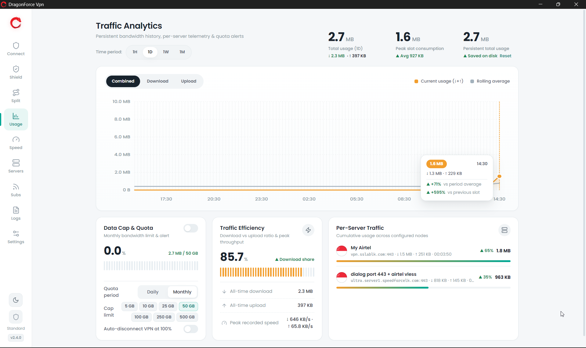 | **Speed Test**<br>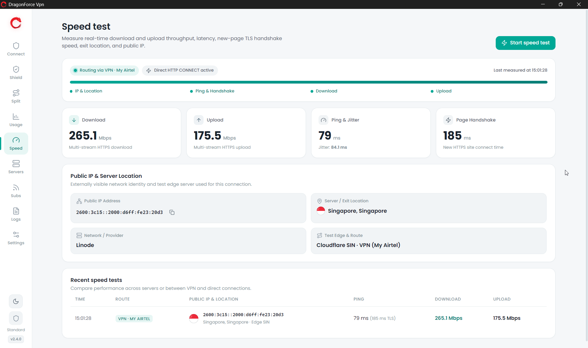 |
| **Subscriptions**<br>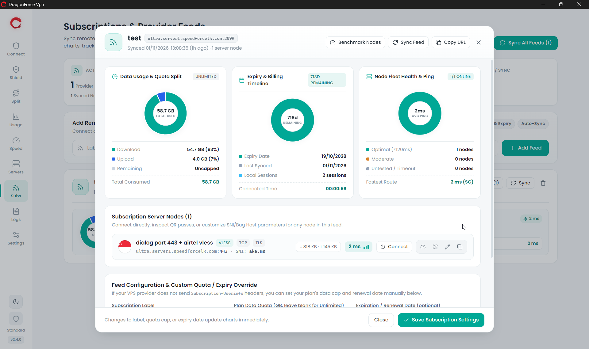 | **Connection Logs**<br>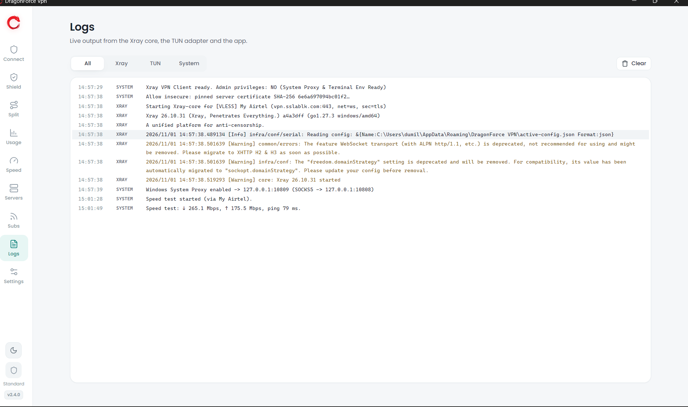 |
| **QR Sharing**<br>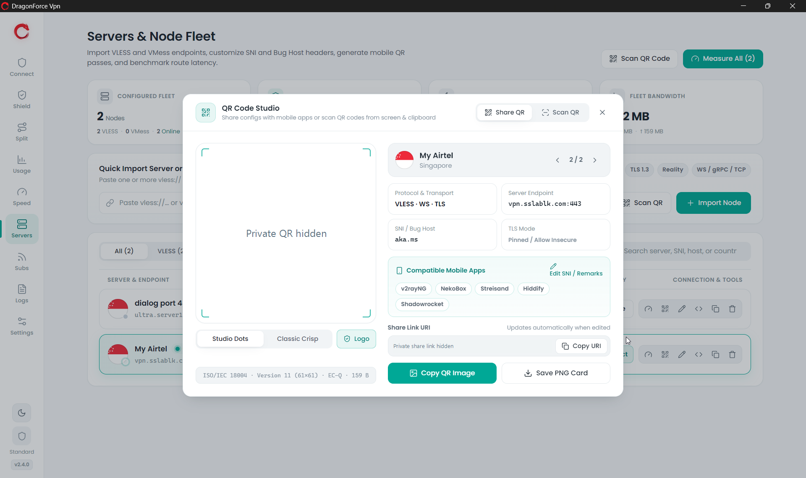 | **QR Scanner**<br>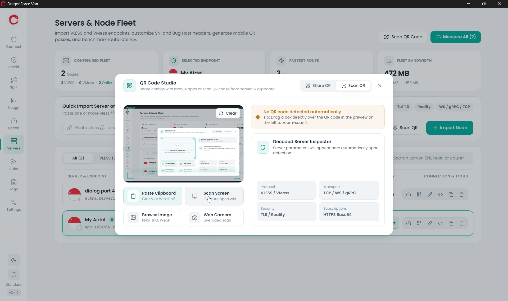 |
| **Settings**<br>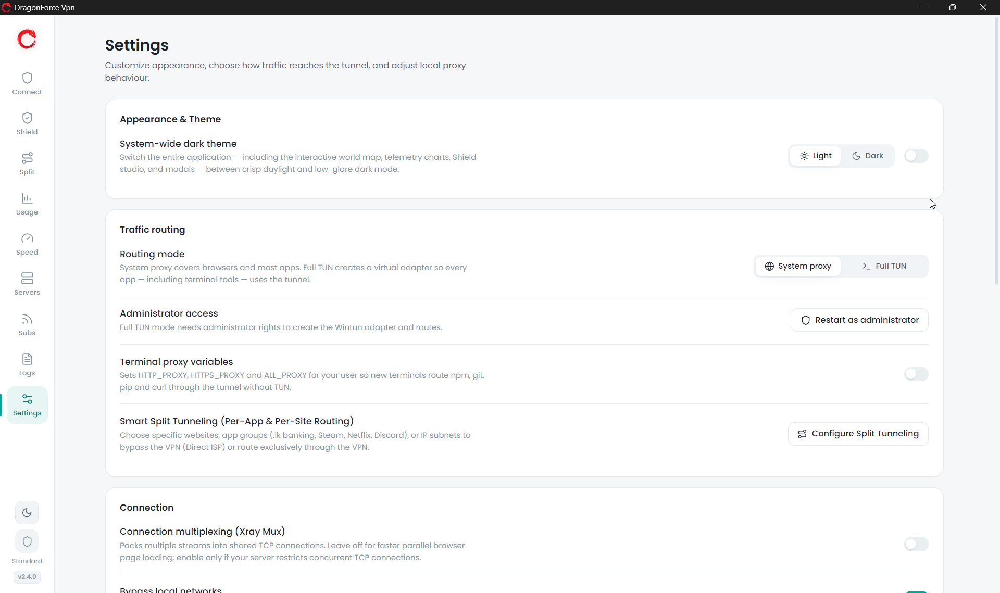 | **Dark Theme**<br>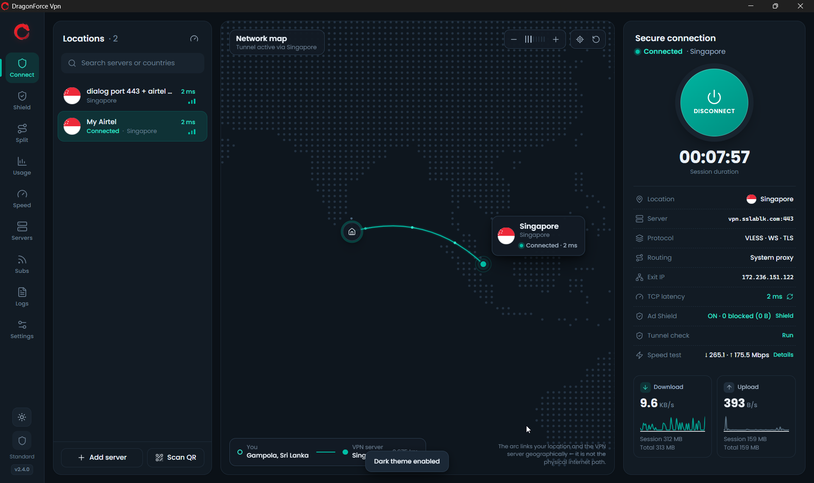 |

</details>

## Build from source

Use a **Windows x64** development machine with **Node.js 22.18 or newer**, npm, PowerShell, and `tar.exe`. Download or clone this repository, then open PowerShell in the project folder.

### Run locally

```powershell
npm.cmd ci
npm.cmd run setup:bins
npm.cmd start
```

This installs dependencies, downloads the x64 development engines, builds the app, and launches it. Development profiles are saved in the project's `data/` folder.

### Build Windows releases

```powershell
npm.cmd run release:win
npm.cmd run release:verify
```

The build runs checks and tests, downloads verified release engines, and packages the universal installer and all three portable EXEs. The verification step checks the packaged files and generates checksums and build information in `release/`.

For packaging details and executable smoke checks, see [RELEASE.md](RELEASE.md).

### GitHub Actions

Pushes to `main` and pull requests run Windows checks, tests, and a build. Pushing a version tag such as `v2.4.1` builds all four Windows EXEs, verifies them, and publishes a GitHub Release with checksums and notes from [CHANGELOG.md](CHANGELOG.md).

See [Publishing a release](RELEASE.md#publishing-a-release) for the version and tagging commands.

### Run checks

```powershell
npm.cmd run typecheck
npm.cmd test
```

## Contributing

**Contributors are welcome!** Bug reports, feature ideas, documentation, design improvements, and code contributions are all appreciated.

Fork the repository, create a branch, make a focused change, and open a pull request describing what you improved. Run the relevant checks before submitting code changes, and include screenshots for interface changes. You can also use **Issues** to report a problem or suggest a feature.

## Credits

Created and maintained by **DragonForce**.

Built with [Electron](https://www.electronjs.org/), [Xray-core](https://github.com/XTLS/Xray-core), [tun2socks](https://github.com/xjasonlyu/tun2socks), and [Wintun](https://www.wintun.net/).
